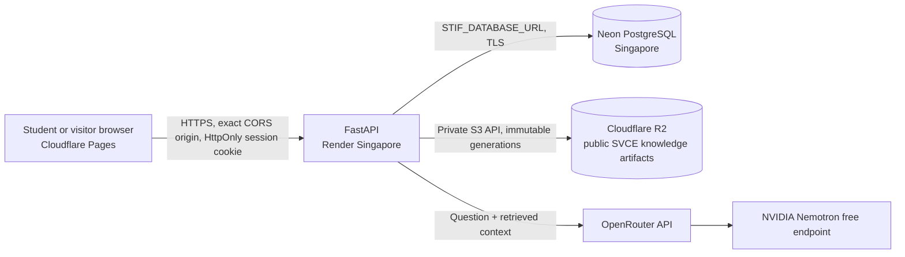

# STIF Campus AI — Demo Readiness

Status: local demo workflow verified; hosted services and external integrations are not configured. No actual college integration, official approval, or production security certification is claimed.

## Architecture prepared for a future hosted demo

This diagram is a target topology only. Current execution remains local. The R2 adapter does not store chat attachments or student records. The chatbot sends user questions, RAG context, and potentially attachment text to the selected OpenRouter model provider.

## Founder demo walkthrough

Use only synthetic accounts and clearly label the demonstration database as test data.

1. Open the public landing page, confirm SVCE Tirupati identity, navigate to admissions information, and review source links where shown. Do not describe retrieved text as a college-confirmed fact unless it has been independently verified.
2. Ask a general question in the assistant. Explain that it is grounded in available SVCE documents, that it may return the safe fallback when the LLM or index is unavailable, and that official sources should be checked for decisions.
3. Register a synthetic student such as `demo.student@example.test`; submit a clearly fictional test enquiry with a phone number reserved for test use.
4. Confirm the student dashboard lists only that account's enquiry. Sign out and demonstrate the protected page redirect.
5. Sign in with a synthetic admin created through `python -m api.manage create-admin`; show the enquiry queue, search, status update and programme controls. Do not add an unverified real programme to the hosted demo.
6. Show `/health` and `/ready` only as operational checks. Explain that database, object storage and deployment persistence still require the separate owner approval and setup steps.

The 46-step local browser run used synthetic student/enquiry data in a disposable SQLite database. It is not a hosted persistence or real OpenRouter test.

## Cost envelope (checked 2026-11-20; verify before purchase)

- **Render API:** prepared for the paid Starter web service, currently listed at **$7/month**. Free web services have limitations and are not a dependable always-on demo. The application needs external persistence because service filesystems are ephemeral by default. [Render pricing](https://render.com/pricing), [web services](https://render.com/docs/web-services), [regions](https://render.com/docs/regions).
- **Cloudflare Pages:** static site Free plan may be sufficient for a small demo; current published limits include **500 builds/month** and one concurrent build. Domain purchase/renewal is separate. [Pages limits](https://developers.cloudflare.com/pages/platform/limits/).
- **Cloudflare R2:** Standard includes **10 GB-month**, 1 million Class A requests, 10 million Class B requests per month, and no egress charge. Above-quota usage is metered; an R2 subscription is required to enable the service. [R2 pricing](https://developers.cloudflare.com/r2/pricing/), [R2 setup](https://developers.cloudflare.com/r2/get-started/).
- **Neon:** Free includes **100 CU-hours and 1 GB database storage per project per month** as of the latest plan update; compute/storage and reliability constraints must be checked against actual anticipated use. [Neon plan limits](https://neon.com/docs/introduction/plans).
- **OpenRouter:** configured free Nemotron currently displays $0 token pricing, but the free endpoint is rate-limited and has a restrictive data notice (see Security review below). It is not an uptime or privacy guarantee. [Model page](https://openrouter.ai/nvidia/nemotron-3.5-lightning%3Afree).

Indicative minimum fixed hosting spend is therefore about **$7/month**, before any domain, usage above included quotas, taxes, or future paid AI choice. This is not a quote or a cost guarantee. No service or paid resource has been created.

## Production-readiness checklist

- [ ] College approves the privacy notice, enquiry consent text, retention period, data residency, and who may access student records.
- [ ] College explicitly approves the AI data-processing arrangement. Current free NVIDIA Nemotron page says not to send personal or confidential information and states free-endpoint session data can be logged to improve NVIDIA products. Do not send enquiries, student names/contact details, or private attachments to this model. Choose a suitable provider/model and review its written terms before launch. [OpenRouter privacy policy](https://openrouter.ai/privacy), [Nemotron free endpoint notice](https://openrouter.ai/nvidia/nemotron-3.5-lightning%3Afree).
- [ ] Owner creates Neon/R2/Render/Pages accounts and privately configures credentials; no credentials belong in Git, Vite variables, issue text, or screenshots.
- [ ] Owner selects a domain and configures the frontend and API on same-site HTTPS hostnames; set exact `STIF_CORS_ORIGINS`, verify cross-origin credentialed login/logout and CSRF behavior in supported browsers.
- [ ] Capture, review and approve a fresh SQLite snapshot before any production migration. Verify PostgreSQL import counts, foreign keys, indexes, and account workflows. Keep the original SQLite file and backup untouched until rollback/retention is approved.
- [ ] Approve an initial R2 upload of public knowledge artifacts only; review contents first. Never upload student records, confidential documents, or user attachments without written data-handling approval.
- [ ] Verify `/ready`, startup migrations, backups, restore, session invalidation, rate limiting, and alerting on deployed services.
- [ ] Decide how to share login/register rate limits across multiple API instances. Current limiter is per-process; do not scale out until this is addressed or accepted with monitoring.
- [ ] Add college-approved real programme data only after verification. The application does not seed programme claims by design.
- [ ] Complete AI grounding review, provider failure handling, HTTPS, cookie, CORS, upload limits, and security review on final hosted domains.

Manual or unresolved items: account/provider setup, exact domain/cookie design, data-processing approval for OpenRouter, retention/cleanup of old immutable R2 generations, production-grade distributed rate limiting, backup ownership, and final cost acceptance.
